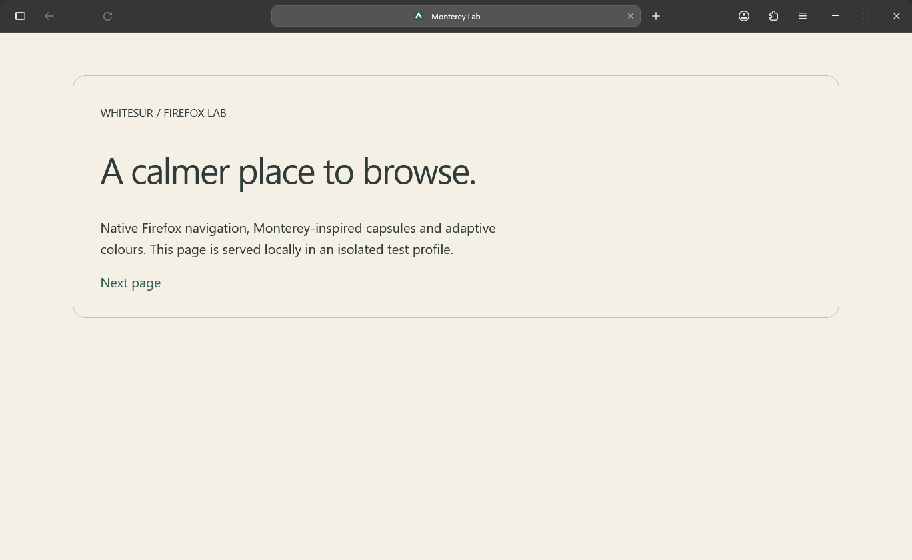

# WhiteSur Monterey Adaptive für Windows

Ein Monterey-inspiriertes, adaptives Firefox-Theme für Windows 11.

**Full funktioniert jetzt standardmässig ohne Firefox AutoConfig.** Die Methode
Compatible installiert nur Profil-CSS und kann neben `zscaler.cfg` und anderen
vorhandenen Konfigurationen verwendet werden. Firefox-Installationsdateien,
Unternehmensrichtlinien und Sicherheitseinstellungen bleiben unverändert.
Administratorrechte und ein zusätzlicher Loader sind nicht erforderlich.



## Installation

1. Full-ZIP herunterladen und entpacken oder Repository klonen.
2. Firefox vollständig schliessen.
3. `Install.cmd` starten. Firefox öffnet sich mit dem ausgewählten Profil.

Der Installer erkennt das Installations-Standardprofil, sichert einen bestehenden
`chrome`-Ordner und erhält eigene `customChrome.css`-Anpassungen bei Updates.
Ein verwalteter `user.js`-Block aktiviert Stylesheets. Vorhandenes AutoConfig wird
erkannt; Compatible Full bleibt die automatische Wahl. Gesperrte Einstellungen
werden respektiert. Wenn Unternehmensrichtlinien Profil-CSS verbieten, kann das
Theme nicht angewendet werden; die Sperre wird nicht umgangen.

```powershell
.\Install.cmd
.\Install.cmd -InstallationMethod Compatible
.\Install-Lite.cmd
# Nur explizit, für saubere Firefox-Installationen ab Version 158:
.\Install.cmd -InstallationMethod AutoConfig
```

Lite installiert immer das klassische Layout, auch beim direkten Aufruf des
PowerShell-Installers. Der optionale alte Loader verweigert fremdes AutoConfig.
Bestehende cfg- und Loader-Pref-Dateien werden niemals neu geschrieben, auch
nicht WhiteSur-eigene Dateien. Details: [Methoden und Funktionsvergleich](docs/COMPATIBILITY.md).

## Aussehen und Bedienung

Full erhält die kompakte Monterey-Toolbar, zentrierte Tab-Titel und Favicons,
abgerundete Kapseln, echte Windows-Fensterknöpfe und native Firefox-Suchvorschläge.
Ein einzelner Tab bildet eine zentrierte Kapsel. Standard-Theme-Erweiterungen wie
[Adaptive Tab Bar Color](https://addons.mozilla.org/firefox/addon/adaptive-tab-bar-colour/)
können weiterhin die Farben liefern.

Mit CSS-Ankerunterstützung folgt das echte Firefox-Adressfeld dem ausgewählten
Tab. Darüberfahren zeigt das Feld, ein Klick aktiviert die Eingabe. `Strg+L`,
`Alt+D` und F6 funktionieren nativ. Ein Klick auf die Webseite zeigt wieder den
Titel. Escape verwendet das normale Firefox-Verhalten und kann den Fokus im Feld
belassen. Tab-Aussenränder bleiben für natives Ziehen und Tab-Kontextmenüs
verfügbar; die Mitte verwendet die Aktionen des Adressfelds.

Normale Tabs reservieren 280 Pixel breite Eingabeplätze. Auswahl und Fokus
ändern dadurch keine Breiten nach der nativen Scroll-Berechnung; bei vielen
Tabs wird früher gescrollt als beim dichteren alten JavaScript-Layout.

Bis 980 CSS-Pixel Fensterbreite, ohne CSS-Anker oder bei einem ausgewählten
angehefteten Tab nutzt Full eine separate Adress- und Tab-Zeile. Vertikale Tabs
behalten ihre Sidebar. Lite behält das bisherige klassische Layout.

Exaktes Zweitklick-Verhalten, eigene Schliessanimationen, Mittelklick-Schliessen
im Eingabefeld und fest eingebaute `g`/`q`-Suche benötigen weiterhin das alte
privilegierte Skript. Native Suchkürzel/Lesezeichen-Schlüsselwörter können die
Suchpräfixe ersetzen. Full Compatible nutzt native Tab-Animationen und
berücksichtigt reduzierte Bewegung für Theme-Übergänge.

## Update, Prüfung und Deinstallation

Firefox schliessen und `Install.cmd` erneut starten. Ein älteres Full-Profil
wechselt standardmässig auf Compatible; sein privilegiertes Skript wird entfernt.
Gemeinsam verwendete AutoConfig-Dateien bleiben unangetastet. Normale Updates und
Verknüpfungen funktionieren weiter. Ein explizites `-RuntimeDirectory` behält aus
Kompatibilitätsgründen die alte Bedeutung; `-InstallationMethod Compatible`
erzwingt auch dann reine Profilinstallation.

`Check-Installation.cmd` zeigt Profil, Version, Methode, erkanntes fremdes
AutoConfig und vorhandene dateibasierte Richtlinien. `about:policies` bleibt die
zuständige Ansicht für aktive Unternehmensrichtlinien.

Firefox schliessen und `Uninstall.cmd` starten. Verwaltete Einstellungen werden
entfernt und ein vorheriger `chrome`-Ordner wiederhergestellt, sofern vorhanden.
Firefox und gemeinsam verwendete Loader bleiben installiert.

## Entwicklung und Grenzen

Die Änderungen wurden mit Firefox 159.0 unter Windows 11 in isolierten Kopien
und Profilen getestet, einschliesslich aktivem synthetischem `zscaler.cfg`, einer
gesperrten Laboreinstellung und einer aktiven Unternehmensrichtlinie. Screenshots
decken schmale und breite Fenster, viele Tabs, Suchvorschläge, helle/dunkle Themes,
Vollbild, vertikale Tabs und private Fenster ab. Quellen, Alternativen und die
vollständige Funktionsmatrix stehen in [COMPATIBILITY.md](docs/COMPATIBILITY.md);
Testbefehle und Ergebnisse in [TESTING.md](docs/TESTING.md).

Browser-Chrome-CSS ist keine stabile öffentliche Mozilla-Schnittstelle. Künftige
Firefox-Änderungen können Anpassungen erfordern. Dies ist ein inoffizielles
Community-Projekt ohne Verbindung zu Mozilla, Apple oder den Upstream-Autoren.

## Basis und Inspiration

Das Projekt basiert stark auf beziehungsweise wurde inspiriert von:

- [WhiteSur Firefox Theme](https://github.com/vinceliuice/WhiteSur-firefox-theme) von Vince Liuice — wichtigste visuelle und CSS-Basis
- [Firefox GNOME Theme](https://github.com/rafaelmardojai/firefox-gnome-theme) von Rafael Mardojai und Mitwirkenden — Ideen für Firefox-Chrome und Layout
- [WhiteSurFirefoxThemeMacOS](https://github.com/AdamXweb/WhiteSurFirefoxThemeMacOS) von AdamXweb — Ideen für WhiteSur-Anpassungen unter Windows und macOS

Weitere Angaben stehen in [`THIRD_PARTY_NOTICES.md`](THIRD_PARTY_NOTICES.md) und im Ordner [`licenses/`](licenses/).

## Lizenz

Die Windows-Anpassung, der Installer, die Tests, Dokumentation und Änderungen dieses Repositories stehen unter **GNU Affero General Public License v3.0 oder später** (`AGPL-3.0-or-later`). Siehe [`LICENSE`](LICENSE).

Übernommene Bestandteile behalten die Copyright- und Lizenzhinweise ihrer ursprünglichen Projekte. Die hauptsächliche WhiteSur-Basis steht unter MIT; der entsprechende Hinweis bleibt im Repository erhalten.
