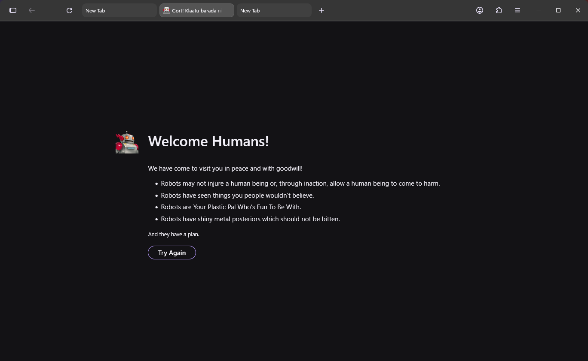

# WhiteSur Monterey Adaptive für Windows

Ein **Monterey-inspiriertes, adaptives Firefox-UI-Theme für Windows 11**.

Der ausgewählte Tab wird zur nativen Firefox-Adress- und Suchleiste. Tab anklicken und eine Adresse oder Suche eingeben; die übrigen Tabs bleiben kompakt. Adaptive Farben, echte Windows-Fensterknöpfe, Profilerkennung, Backups und Deinstallation bleiben erhalten.

**v0.2.0-beta.1 ist ein grösseres Oberflächen-Update:** Auf unterstützten Firefox-Versionen ersetzen editierbare Tabs die separate Adressleiste. Nach der Installation die neue WhiteSur-Firefox-Verknüpfung verwenden. Änderungen gegenüber den 0.1-Betas stehen in den [Release Notes](docs/releases/v0.2.0-beta.1.md) (Englisch).



> [!IMPORTANT]
> Dies ist ein inoffizielles Community-Projekt und steht in keiner offiziellen Verbindung zu Mozilla, Apple, Vince Liuice, Rafael Mardojai, AdamXweb oder den Entwicklern von Adaptive Tab Bar Color.

## Funktionen

- Monterey-inspirierte Firefox-Oberfläche unter Windows
- echte Windows-Knöpfe für Minimieren, Maximieren und Schliessen rechts
- ausgewählte Tabs als native Adressleiste inklusive Symbolen und Suchvorschlägen
- kompakte Hintergrund-Tabs, die bei Platzmangel schmaler werden
- stabile Tab-Wechsel und Schliessvorgänge ohne animierte Breitenänderungen
- klassische CSS-Toolbar als Fallback für ältere Firefox-Versionen, vertikale Tabs und vorhandene AutoConfig-Setups
- stabiles Spacing bei Vorwärts-, Sicherheits-, Stern- und Page-Action-Symbolen
- sauberes Schliessen von Tabs ohne unsichtbare Lücken
- freie Toolbar- und Tab-Leisten-Bereiche können das Fenster ziehen, ohne Tab-Reihenfolge oder Tab-Abtrennen zu stören
- macOS-inspirierte helle/dunkle Mittelklick-Autoscroll-Anzeige
- adaptive Farben über Firefox-Theme-Variablen
- automatische Erkennung des tatsächlich aktiven Firefox-Profils
- Backup und Wiederherstellung eines vorhandenen `chrome`-Ordners
- eine eigene `customChrome.css` bleibt bei Updates erhalten
- keine Administratorrechte nötig

## Adaptive Farben

Für die adaptive Einfärbung ist das Theme auf **Adaptive Tab Bar Color** ausgelegt:

https://addons.mozilla.org/firefox/addon/adaptive-tab-bar-colour/

Die Erweiterung passt Firefox' Theme-Farben an die aktive Webseite an. Dieses Theme verwendet Firefox' normale Lightweight-Theme-Variablen und übernimmt dadurch die dynamischen Farben.

Ohne die Erweiterung funktioniert das Layout weiterhin, aber die Farben bleiben beim aktuell ausgewählten Firefox-Theme.

## Installation

1. Repository herunterladen oder klonen.
2. Firefox vollständig schliessen; im Task-Manager darf kein `firefox.exe` mehr laufen.
3. `Install.cmd` starten.
4. Die neue Desktop-Verknüpfung **WhiteSur Firefox - &lt;Profil&gt;** öffnen.

Ab Firefox 158 erstellt der Installer eine benutzereigene Firefox-Kopie unter `%LOCALAPPDATA%\Programs\WhiteSur Firefox` und richtet dort den Loader ein. Die ursprüngliche Installation bleibt erhalten. Für editierbare Tabs die WhiteSur-Verknüpfung verwenden; das ursprüngliche Programm verwendet die klassische CSS-Toolbar. Vor einem Wechsel des Launchers Firefox vollständig schliessen.

Normale Eingaben verwenden die Firefox-Standardsuche. `g Suchbegriffe` sucht mit Google, `q Suchbegriffe` mit Qwant. `Strg+L`, `Alt+D` und `F6` fokussieren das Feld. `Esc` verwirft die Eingabe; das Feld bleibt sichtbar.

Nur die klassische adaptive Toolbar installieren:

```powershell
powershell -NoProfile -ExecutionPolicy Bypass -File .\Install-WhiteSur-Monterey-Adaptive.ps1 -ClassicToolbar
```

Details und eigene Installationspfade: [Editable tabs](docs/EDITABLE-TABS.md) (Englisch).

Mit `Check-Installation.cmd` kannst du das erkannte Profil und die installierte Version prüfen.

## Update

Firefox schliessen und `Install.cmd` aus der neuen Version starten. Eine vorhandene `customChrome.css` wird übernommen. Loader-Dateien werden aktualisiert und eine neuere Quellinstallation wird in die WhiteSur-Kopie übernommen; eine neuere Kopie wird nicht zurückgestuft.

## Deinstallation

Firefox schliessen und `Uninstall.cmd` starten. Der Installer entfernt seine verwalteten Preferences und die zugehörige Verknüpfung und stellt nach Möglichkeit das vorherige `chrome`-Backup wieder her. Die gemeinsam genutzte Firefox-Kopie bleibt für andere Profile erhalten. Nutzt sie kein Profil mehr, kann `%LOCALAPPDATA%\Programs\WhiteSur Firefox` manuell entfernt werden.

## Kompatibilität

Version `2026.10.21-21` (`v0.2.0-beta.1`) wurde mit Firefox 158.0.1 unter Windows 11 getestet. Editierbare Tabs benötigen Firefox 158+ mit horizontalen Tabs. Ältere Versionen, vertikale Tabs und erkannte AutoConfig-Konflikte behalten das klassische CSS-Layout mit den bisherigen Firefox-154/156-Korrekturen.

Adaptive Tab Bar Color bleibt kompatibel: beide Layouts verwenden Firefox-Theme-Variablen. Die nativen Tests prüfen helle und dunkle Farbwechsel; das Verhalten einzelner Erweiterungen hängt auch von deren Einstellungen ab.

## Entwicklung

Das Projekt wurde **stark mit ChatGPT vibe-codiert** und danach iterativ in echtem Firefox unter Windows getestet und korrigiert. Besonders intensiv getestet wurden URLbar-Geometrie, Tab-Schliessen, schmale Fenster, dynamisch erscheinende Toolbar-Symbole, Spacing und Fenster-Dragging.

Die aktuellen Tests und Befehle stehen unter [`docs/TESTING.md`](docs/TESTING.md). Dazu gehören echte Firefox-Tests für die Tab-Geometrie und Windows-PowerShell-Tests für Installation, Update, Fallback und Deinstallation.

## Basis und Inspiration

Das Projekt basiert stark auf beziehungsweise wurde inspiriert von:

- [WhiteSur Firefox Theme](https://github.com/vinceliuice/WhiteSur-firefox-theme) von Vince Liuice — wichtigste visuelle und CSS-Basis
- [Firefox GNOME Theme](https://github.com/rafaelmardojai/firefox-gnome-theme) von Rafael Mardojai und Mitwirkenden — Ideen für Firefox-Chrome und Layout
- [WhiteSurFirefoxThemeMacOS](https://github.com/AdamXweb/WhiteSurFirefoxThemeMacOS) von AdamXweb — Ideen für WhiteSur-Anpassungen unter Windows und macOS

Weitere Angaben stehen in [`THIRD_PARTY_NOTICES.md`](THIRD_PARTY_NOTICES.md) und im Ordner [`licenses/`](licenses/).

## Lizenz

Die Windows-Anpassung, der Installer, die Tests, Dokumentation und Änderungen dieses Repositories stehen unter **GNU Affero General Public License v3.0 oder später** (`AGPL-3.0-or-later`). Siehe [`LICENSE`](LICENSE).

Übernommene Bestandteile behalten die Copyright- und Lizenzhinweise ihrer ursprünglichen Projekte. Die hauptsächliche WhiteSur-Basis steht unter MIT; der entsprechende Hinweis bleibt im Repository erhalten.
