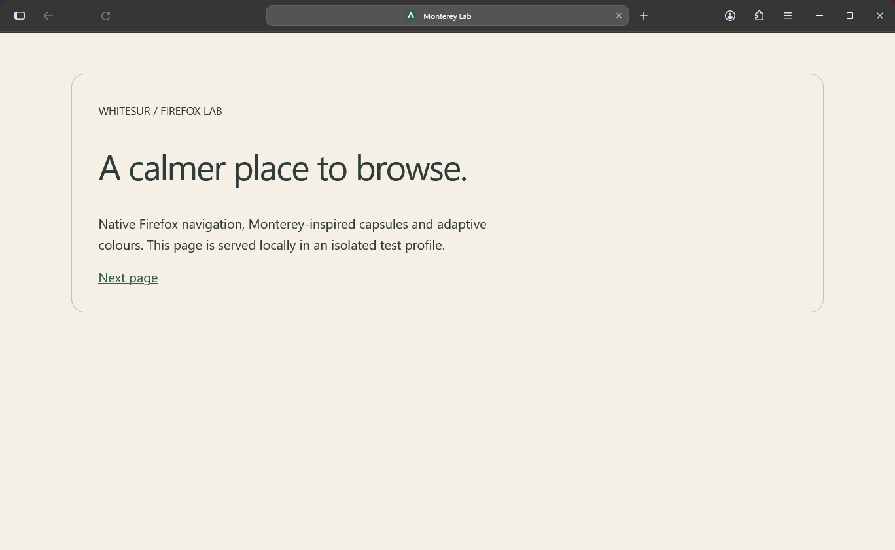

# WhiteSur Monterey Adaptive for Windows

A Monterey-inspired, adaptive Firefox UI theme for Windows 11.

**Full now works without Firefox AutoConfig.** Its default Compatible method
installs only profile CSS and coexists with existing configurations such as
`zscaler.cfg`. Firefox installation files, enterprise policies and security
settings remain untouched. No administrator rights or companion loader are needed.



## Installation

1. Download/extract the Full ZIP or clone this repository.
2. Fully close Firefox.
3. Run `Install.cmd`. Firefox opens with your selected profile.

The installer detects profiles using Firefox's install-default information,
backs up an existing chrome folder, preserves `customChrome.css` on updates,
and adds a managed `user.js` block enabling theme stylesheets. Detected AutoConfig
conflicts are reported and Compatible Full is selected automatically.
Administrator-locked preferences remain authoritative; if custom stylesheets
are forbidden, the theme cannot apply and does not bypass the restriction.

```powershell
# Default Full: profile CSS only
.\Install.cmd

# An explicit profile and executable; paths may contain spaces
.\Install.cmd -ProfilePath "C:\path\to\profile" -FirefoxPath "C:\Program Files\Mozilla Firefox\firefox.exe"

# Lite / original classic layout
.\Install-Lite.cmd

# Legacy privileged interaction implementation, explicit opt-in only
.\Install.cmd -InstallationMethod AutoConfig
```

Full and Lite releases both contain `Install.cmd`. A Lite archive always uses
Classic, including direct PowerShell invocation. The legacy loader requires a
clean Firefox 158+ installation and refuses existing foreign AutoConfig. Existing
cfg and loader-pref files are never rewritten, including WhiteSur-owned files.
See [installation methods and feature comparison](docs/COMPATIBILITY.md).

## Appearance and interaction

Full retains the compact Monterey-inspired toolbar, centred tab titles and
favicons, rounded capsules, native Windows caption buttons, native suggestions
and address-field controls. A lone tab forms a centred capsule.

On Firefox with CSS anchor positioning, the real native address field follows
the selected tab. Hover the selected tab to reveal the field, then click to edit,
or use `Ctrl+L`, `Alt+D`, or F6. `Ctrl+T` uses Firefox's normal new-tab focus.
Clicking the page returns to the title; Escape follows Firefox's native cancel
behavior and may leave the field focused. Background tabs still select normally.
Use tab outer edges for native tab dragging and context menus while the
centre is an address field.

Ordinary tabs reserve 280px editing slots so selection/focus cannot invalidate
Firefox's native visibility calculations. Crowded strips use native scrolling
sooner than the denser legacy JavaScript layout.

At widths at or below 980 CSS pixels, on engines without anchors, or with a
pinned tab selected, Full uses a separate native address field and tab row.
Vertical tabs retain their native sidebar. Tabs stay accessible in narrow Full
windows. Lite retains its original compact CSS layout and responsive behavior.

Full uses Firefox's normal theme variables. For colours that follow each site,
install [Adaptive Tab Bar Color](https://addons.mozilla.org/firefox/addon/adaptive-tab-bar-colour/).
Without it, Firefox's selected theme supplies the colours. A normal theme
WebExtension can supply colours without any privileged browser modifications.

The Compatible method uses native tab motion and respects reduced motion for
theme transitions. Exact second-click activation, custom close snapshots,
middle-click closing inside the address input and hard-coded `g`/`q` routing
remain legacy-script features. Configure Firefox's native search shortcuts or
bookmark keywords for equivalent search prefixes. The complete limitations and
alternatives analysis are in [COMPATIBILITY.md](docs/COMPATIBILITY.md).

## Update, diagnose and uninstall

Close Firefox and rerun `Install.cmd` to update. An older Full profile migrates
to Compatible CSS and its privileged profile script is removed. Existing shared
AutoConfig files remain untouched for other profiles. Normal Firefox updates and
shortcuts keep working. An explicit `-RuntimeDirectory` retains its legacy
meaning; pass `-InstallationMethod Compatible` to override old runtime arguments.

`Check-Installation.cmd` reports profiles, version, installed method, detected
foreign AutoConfig and file-based policy presence. It does not replace
`about:policies` or claim to enumerate all effective enterprise preference locks.

Close Firefox and run `Uninstall.cmd` to remove managed preferences and restore
the previous chrome backup when available. Firefox and existing shared loaders
remain installed. Unrelated preferences and policies are preserved.

## Development and validation

The change was tested in real Firefox 159.0 on Windows 11 using isolated copies
and profiles, including an actively loaded synthetic `zscaler.cfg`, a locked lab
preference and an active enterprise policy. No company configuration is needed
for the tests. Screenshots cover wide/narrow layouts, crowded tabs, suggestions,
built-in themes, a normal theme extension, fullscreen, vertical and private windows.

```powershell
powershell -NoProfile -ExecutionPolicy Bypass -File tests/test_compatible_installer.ps1
powershell -NoProfile -ExecutionPolicy Bypass -File tests/test_installer.ps1
python tests/test_compatible_firefox.py --firefox "C:\clean-firefox\firefox.exe" --geckodriver "C:\tools\geckodriver.exe"
python tests/test_release_packages.py
```

The native suite copies the supplied clean browser before adding harmless lab
fixtures; it never modifies that source installation. Run native suites
sequentially because Windows input focus is shared. See [testing instructions
and recorded results](docs/TESTING.md), [the feature audit](docs/COMPATIBILITY.md)
and [legacy loader setup](docs/EDITABLE-TABS.md).

Mozilla does not provide a stable public API for third-party browser chrome CSS.
Future Firefox UI changes can require theme updates. This is an unofficial
community project, unaffiliated with Mozilla, Apple or the upstream theme authors.

## Upstream and inspiration

This project is **heavily based on and inspired by**:

- [WhiteSur Firefox Theme](https://github.com/vinceliuice/WhiteSur-firefox-theme) by Vince Liuice — the main visual and CSS base
- [Firefox GNOME Theme](https://github.com/rafaelmardojai/firefox-gnome-theme) by Rafael Mardojai and contributors — layout and Firefox chrome implementation ideas
- [WhiteSurFirefoxThemeMacOS](https://github.com/AdamXweb/WhiteSurFirefoxThemeMacOS) by AdamXweb — Windows/macOS WhiteSur adaptation ideas

The Windows geometry, installer, responsive behaviour, regression tests, URL-bar containment fixes, tab-close handling, and packaging in this repository were adapted specifically for this project.

See [`THIRD_PARTY_NOTICES.md`](THIRD_PARTY_NOTICES.md) and the files in [`licenses/`](licenses/) for attribution and upstream licence texts.

## Licence

The Windows adaptation, installer, tests, documentation, and modifications in this repository are licensed under the **GNU Affero General Public License v3.0 or later** (`AGPL-3.0-or-later`). See [`LICENSE`](LICENSE).

Portions derived from upstream projects retain their original copyright and licence notices. In particular, the main WhiteSur Firefox source is MIT-licensed. The required notices are preserved in `licenses/` and `THIRD_PARTY_NOTICES.md`.

The AGPL choice applies to this combined adapted distribution and to original contributions in this repository. It does not remove the upstream authors' ability to distribute their original code under their original licences.

## Trademark note

Firefox and the Firefox logo are trademarks of the Mozilla Foundation. macOS, Monterey, and Safari are trademarks of Apple Inc. WhiteSur is used descriptively to identify the upstream visual project and style inspiration.
